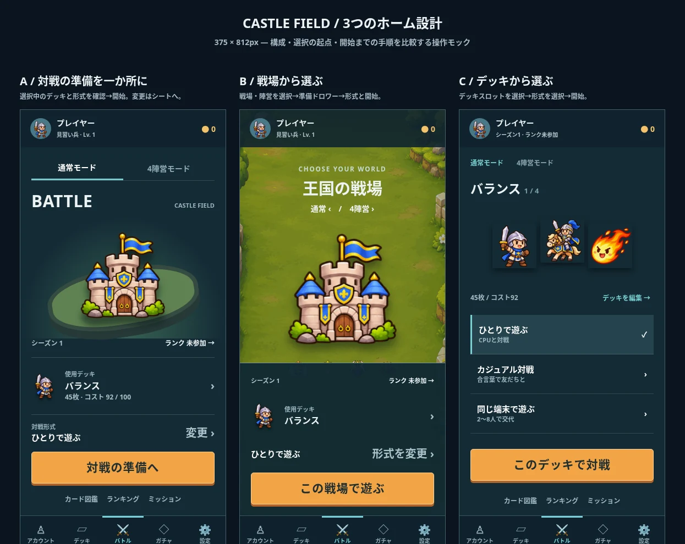
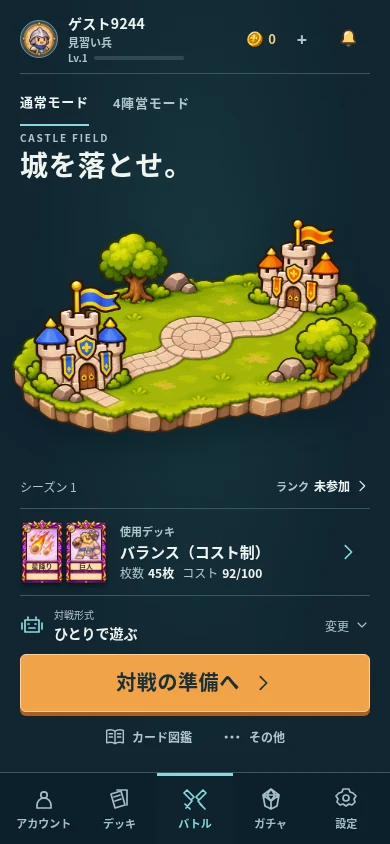
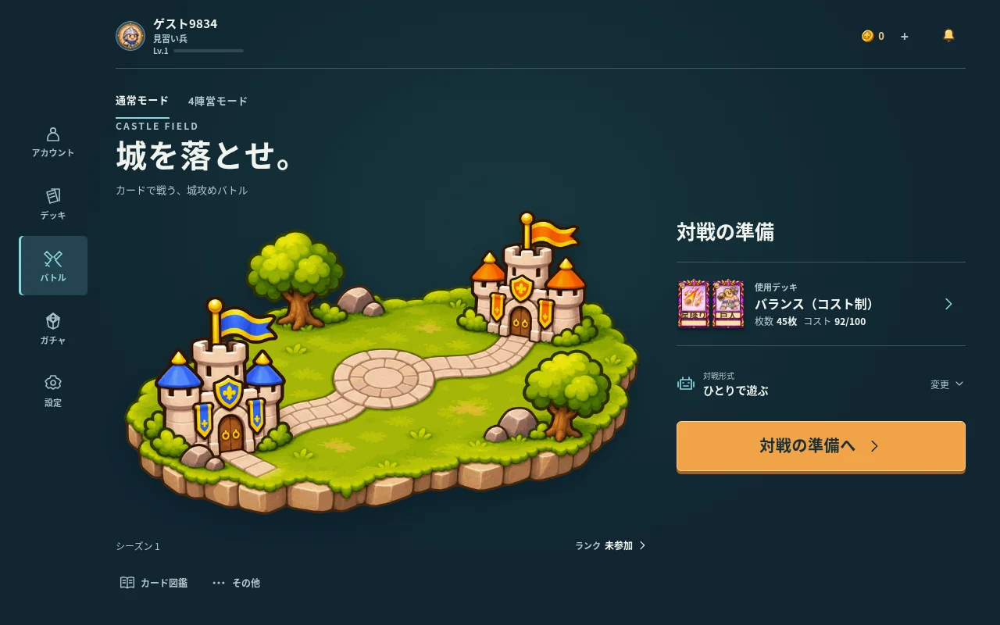

# Castle Field — ホームと対戦準備の再設計

商用5作品の実画面を比較し、3つの異なる情報設計をHTMLで制作した。起動から開始までの条件確認を一か所にまとめるA案を採用し、実際のゲームへ実装。単一の画像をクリック領域にした画面ではなく、プロフィール、ナビ、デッキ、形式選択、開始、準備画面はHTML/CSS/JavaScriptで動く。

## 調査・設計

- [実画面5作品の研究と出典](research.md)：Clash Royale、MARVEL SNAP、Hearthstone、Pokémon TCG Pocket、Legends of Runeterra。画面の年代と、観察からの推定を明記。
- [既存機能の対応と情報設計](information-architecture.md)
- [3案の比較・採用理由](decision.md) / [操作モック](concepts.html)
- [デザインシステム](design-system.md)
- [撮影→自己レビュー→修正の記録](review-log.md)



## 実装後のホーム

| スマホ 390×844 | PC 1280×800 |
|---|---|
|  |  |

[375×812](after-375.webp) / [390×844](after-390.webp) / [430×932](after-430.webp) / [1280×800](after-1280.webp)

通常と4陣営を上部で切り替え、使用デッキ／陣営、対戦形式、開始を下部に集約。形式・デッキ・その他の機能は、実際のnative dialogで選ぶ。PCは戦場と準備を二列にし、ナビを左へ移す。長いタブの内容はナビより上の領域でスクロールする。

[対戦形式](mode-sheet.webp) / [デッキ選択](deck-sheet.webp) / [その他](more-sheet.webp) / [CPU準備](solo-setup.webp) / [同じ端末の準備](local-setup.webp) / [4陣営ホーム](factions-home.webp) / [陣営選択](faction-sheet.webp) / [図鑑](catalog.webp) / [アカウント](tab-account.webp) / [デッキ](tab-deck.webp) / [ガチャ](tab-shop.webp) / [設定](tab-settings.webp)

## 変更前・初回実装との比較

| 解像度 | 変更前 | 初回実装 | 修正後 |
|---|---|---|---|
| 375×812 | [画像](before-375.webp) | [画像](iteration-1-375.webp) | [画像](after-375.webp) |
| 390×844 | [画像](before-390.webp) | [画像](iteration-1-390.webp) | [画像](after-390.webp) |
| 430×932 | [画像](before-430.webp) | [画像](iteration-1-430.webp) | [画像](after-430.webp) |
| 1280×800 | [画像](before-1280.webp) | [画像](iteration-1-1280.webp) | [画像](after-1280.webp) |

初回に残った旧装飾、小さなタップ領域、準備画面の古い構成、景品名の低コントラストを修正。追加の実操作で見つかった下端の重なりも、タブのスクロール領域を分離して直した。[修正前の重なり](scroll-review-account.webp)

## 素材

[制作記録](assets.json) / [出典](../../CREDITS.md)

通常用の二城の戦場と、4陣営用の四城の戦場をOpenAI画像生成で制作。透過PNG、960px幅、2点合計277,771バイト（約271KiB）。1枚300KB以下。元画像は `source-duel.webp`、`source-factions.webp` に保存。ナビと操作アイコンは共通24pxグリッドのSVGで実装した。参考作品の固有アート・UI画像は製品へ取り込んでいない。

## 機能・検証

| 確認 | 結果・記録 |
|---|---|
| 通常・4陣営・既存classicのデータ読込、URL切替 | `node ui-tests/home-ruleset.js` |
| 指定4解像度、タブ、形式・デッキのシート、準備、図鑑、設定、下端の操作、矢印/Home/End、フォーカス復帰 | `ui-tests/home-lobby.js` / [結果](layout-check.json) |
| 保存枠を変更した後の、表示デッキと実際の山札の一致 | 同上。カード種別ごとの全枚数で比較 |
| 竜族を選択して開始し、自分の手札・デッキが竜族になる | 同上 / [対戦画面](factions-battle.webp) |
| 通常対戦→結果→再戦 | `ui-tests/smoke.js`、51手番、41枚使用、エラー・同期警告なし / [結果](smoke-check.json) |
| デッキ名変更・保存・フィルター・拡大・ローカル開始・オンライン部屋選択 | `ui-tests/deck-editor.js`、390×844・360×640 |
| ショップ購入、装備、ガチャ1回/10連、対戦中のスキン反映 | `ui-tests/collection.js` |
| 3Dの両城読込、ホームで描画停止、次の対戦で再開 | [結果](3d-check.json) / [画面](battle-3d.webp) |
| オフラインでホーム→4陣営切替→竜族選択→同じ端末で開始 | `ui-tests/home-offline.js` / [結果](offline-check.json) |
| 既存の自動テスト | `node --test` 742/742通過 / [結果](node-check.json) |
| 素材容量・寸法・参照・構文・整合性 | PNG各300KB未満、JS構文、`git diff --check`、PWA一覧再生成 |

PlaywrightとChromiumで検証。共通の実行例：

```sh
UI_TEST_URL=http://127.0.0.1:8040/ UI_TEST_CHROMIUM=/usr/bin/chromium node ui-tests/home-lobby.js
UI_TEST_URL=http://127.0.0.1:8040/ UI_TEST_CHROMIUM=/usr/bin/chromium UI_TEST_FIELD3D=2d node ui-tests/smoke.js
UI_TEST_URL=http://127.0.0.1:8040/ UI_TEST_CHROMIUM=/usr/bin/chromium UI_TEST_FIELD3D=2d node ui-tests/deck-editor.js
UI_TEST_CHROMIUM=/usr/bin/chromium UI_TEST_FIELD3D=2d node ui-tests/collection.js
UI_TEST_URL=http://127.0.0.1:8040/ UI_TEST_CHROMIUM=/usr/bin/chromium node ui-tests/home-offline.js
```

通しのUI試合は検証環境のGPU制約を避けて2Dで実施し、3Dは別に読み込み・停止・復帰を確認した。ソフトウェア描画で記録したfpsは実機の性能指標ではない。

## 前提と残課題

- PR #188の陣営エンジン・カード・素材を土台に、PR #189の画面側の3D座標／2D復帰修正も反映。ゲームロジック、カード数値、サーバーは変更していない。
- 4陣営の固定デッキをローカルへ接続した。4陣営のオンラインはサーバー側PR #182との統合が別途必要で、選択画面に準備中と明記。通常モードのオンライン導線は維持。
- iOS/Android実機のセーフエリア、実指での片手操作、低性能端末の性能は未検証。
- プレイヤーによる探索・開始成功率・遊びたいと感じるかの評価は未実施。研究と作り手の自己レビューをユーザーテストの代替とは扱わない。
