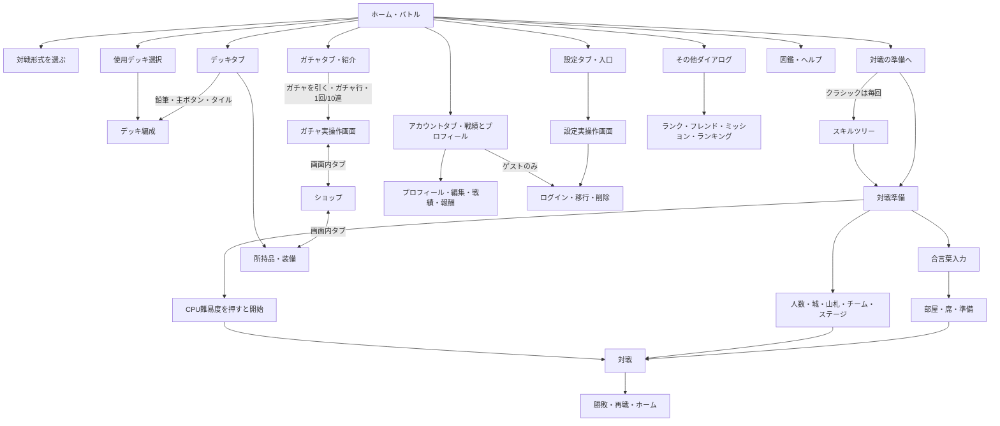
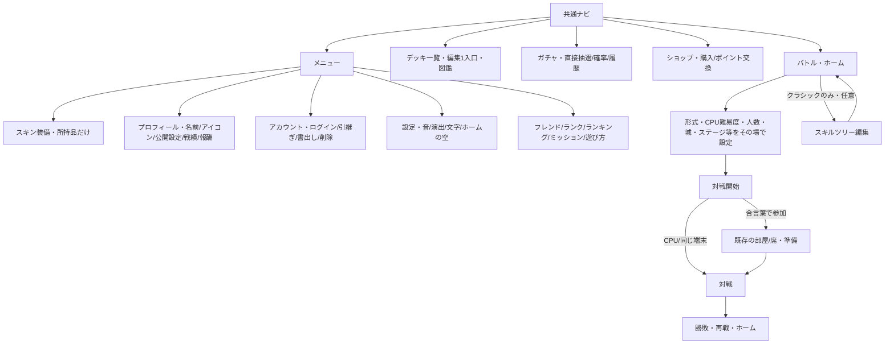
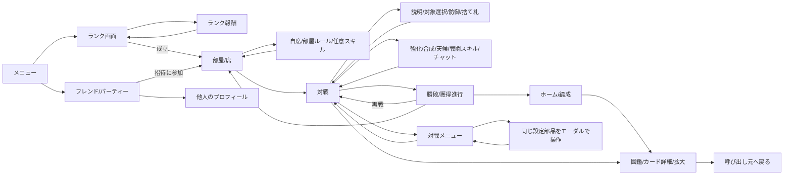

# 画面構成・操作導線の監査と再設計

調査基点: PR #202 / c3f148e。対象は Home、CollectionView、Settings、ProfileView、AccountPanel、LocalSetup、main の画面接続と index.html。ゲームの計算・定義は対象外。

## 改修前の遷移



| 問題 | ボタンの実際の役割 | 修正方針 |
|---|---|---|
| ガチャの二重画面 | 紹介画面のボタンから別のガチャ操作画面を開く | タブ内で直接抽選・確率・履歴を見る |
| ショップと装備が混在 | 同じモーダルのタブで購入と装備を切り替える | 購入/ポイント交換と所持品の装備を独立ページに分ける |
| デッキ画面の入口が3つ | 鉛筆・中央の編集・下部の編成タイルは同じ処理 | 編集主ボタン1つ。選択と編集の文言・役割を分ける |
| 設定タブが入口のみ | さらに設定行を押して設定モーダルへ進む | 設定ページに既存の操作部品を直接配置 |
| アカウントとプロフィールの混同 | 戦績/レベルが2画面に重複、名前編集も2か所 | プロフィール=公開名/アイコン/戦績/報酬、アカウント=認証/データ管理 |
| CPU難易度が開始ボタン | 選択だけしたつもりで試合が始まる | 独立した保存可能な選択。開始はホームの主ボタンのみ |
| 開始前の中間画面 | ホームで選んだデッキを準備画面で再設定 | 人数/城/ステージ等もホーム内に配置 |
| 毎回のスキルツリー | 決定するまで対戦を始められない | クラシックのホームから任意編集。開始は保存済みビルドを使用 |
| 戻る操作 | モーダルは閉じる、準備はホーム、内側のタブは元の場所が不明確 | 主タブと二次ページを分離。二次ページにメニューへの戻る、編集ダイアログは呼び出し元へ |

図鑑・ヘルプ・フレンド・ランキング・ミッション・部屋/席・戦闘メニュー・結果・再戦は既存機能として残す。オンラインの待機室は相手と席を同期する目的があるため撤去しない。

## 新しい構成



主ナビはデッキ・ガチャ・バトル・ショップ・メニューの5項目。スキン/プロフィール/設定はメニューから独立ページへ入り、共通ナビを維持する。設定やガチャの「入口だけのページ」を作らない。ショップは取得、装備は使用、プロフィールは公開情報、アカウントは認証・データ保全、と役割を明示する。

通常はコスト編成と既存の共通/個別山札設定、4陣営は陣営選択と固定デッキ、クラシックは共通山札と任意スキル編集を提示。CPU難易度はCPU形式のみ、合言葉はオンラインのみ表示。通常専用のランク等は他モードでは表示しない。

## 実装した画面と戻り方

| 行き先 | 直接できること | 戻り方 |
|---|---|---|
| バトル | ルールセット、対戦形式、難易度、人数、城、勝ち方、チーム、ステージ、通常の山札/使用枠、4陣営の陣営、合言葉 | 主ナビを維持。CPU/同じ端末は唯一の開始ボタンで既存の開始処理を呼ぶ |
| デッキ | 枠選択、プレビュー、コピー/削除、編集主ボタン1つ、図鑑 | 編成ダイアログを閉じると元のデッキページ |
| ガチャ | 1回/10連、排出率/景品、天井、履歴、獲得演出 | 別のガチャ画面を開かず、その場で操作 |
| ショップ | アイテム購入、従来ガチャ内にあったポイント交換 | 主ナビ。装備操作は含めない |
| スキン装備 | 所持アイテムだけを表示、装備/解除、種類別フィルタ | 呼び出し元のメニュー/バトルに戻るボタンとEscape |
| プロフィール | 公開名、アイコン、公開範囲、戦績、履歴、レベル報酬。接続のない環境ではローカル名 | 呼び出し元へ戻る。アカウント側の重複した名前編集は撤去 |
| アカウント管理 | 登録/ログイン、連携、パスワード変更、データ競合解決、書き出し、ログアウト、削除 | メニューから直接開き、閉じると同じ場所。設定を経由しない |
| 設定 | 音量、演出速度、動きを減らす、文字、ホームの空、端末の戦績リセット | 操作部品を直接配置。ページ内はフォーカスを閉じ込めず、Escapeで呼び出し元へ。対戦メニューでは同じ部品をモーダル表示 |
| スキルツリー | クラシックのホームから任意編集、保存、再読み込みで復元 | 決定/戻るでホームへ。開始時には表示しない。既存の部屋の自席編集も維持 |

CollectionView/Settings/ProfileViewは同じインスタンスをページへ移し、入力・イベント・API処理を複製していない。共通のviewPlacementでページ内領域とモーダルの意味/フォーカス復帰を切り替える。画面内で同じガチャを再度開く処理や旧準備画面のDOMは撤去した。ランク報酬がランク画面の背面に隠れる既存の不具合も直し、報酬を閉じたらランク画面へ戻るよう接続した。

ショップのポイント交換、全種類のスキン、認証と移行、図鑑、ヘルプ/チュートリアル、フレンド/招待、ランク/報酬/ランキング/ミッション、部屋の席とルール、戦闘メニュー、結果/再戦は残している。オンラインは合言葉をホームで入力して直接入室し、相手との同期が必要な既存の部屋/準備を維持する。対戦中にビルドを書き換える機能は追加していない。

## モードと表示条件

| 項目 | 通常 | 4陣営 | クラシック |
|---|---|---|---|
| 山札 | コスト編成、従来の共通/個別山札も選択可能 | 陣営ごとの固定デッキ | 共通の山札 |
| 固有設定 | 使用デッキ枠 | 4陣営の城/紋章を選択 | スキルの個数と任意編集 |
| 編成 | 編集主ボタンを表示 | 固定構成の閲覧 | 共通山札の説明と図鑑 |
| ランク等の通常専用メニュー | 表示 | 非表示 | 非表示 |

難易度はCPU形式のみ、合言葉はオンラインのみ。人数・城・勝ち方・チーム・ステージはCPU/同じ端末のホーム内「対戦設定」。難易度と詳細設定はルールセット別に端末へ保存する。通常で使用枠を変えた後も、実際の山札へ同じ枠を渡す。従来の見本コストデッキ3種も同じ選択シートに残し、選択を保存する。「この見本から編成」は空き枠に下書きを作り、保存済みの枠を上書きしない。個別山札の選択には従来のカードプレビューも配置した。無効な保存デッキを見本へ切り替える既存の扱いも維持する。

## レイアウトと描画

- 王国ファンタジーの専用絵、CPUの兵士/騎士、城の3D/2D素材、カードを流用。新しい画像生成やゲーム絵の描き替えはしていない。
- スマホ縦向きは開始ボタン1つを下部へ配置。PC/横向きは設定列内へ配置。同じボタンを移動し、複製しない。
- 固定ナビと開始ボタンの領域をスクロール表示範囲から除外し、ショップなどの下端の操作も隠れないようにした。画面全体の横はみ出しを確認。
- 全画面の編集/図鑑/読み込みパネルの背後、およびホーム以外のページではホーム3Dの最後のフレームを保ち描画ループを停止する。画面表示に関係する変更だけを監視し、ツリーのパンごとに重い走査を行わない。通常の対戦3Dは維持。
- PWAの一覧/ハッシュを再生成。新しいviewPlacementも保存対象。原画PNGとレビュー画像は従来どおり保存対象外。

## 検証結果

- 関連する既存Nodeテスト73件、画像/配線テスト6件成功。モード読み込み/URL切替も成功。
- navigation.js: PC/スマホの実APIで抽選・購入・装備・名前変更・設定保存・オンライン入室が成功。テスト用コインは専用メモリDBだけに投入。実データには触れない。
- PC/スマホ × 通常/4陣営/クラシック × CPU/同じ端末の12経路で直接開始。3人と氷ステージの設定が実際のGameに渡り、各モードの山札形式が一致。クラシックの取得→保存→再読込を確認し、開始時の強制表示なし。
- 320×568、390×844、820×1180、844×390、1440×900を確認。追加のhome-lobby.jsは375/390/430/1280幅で主要44px領域、開始とナビの非重複、キーボード、ページ下端の操作、選択枠と実カードの一致、無効デッキのコピー/削除を検証。エラーなし。
- 実タップ、ヘッダーからのプロフィールと戻り先、接続失敗から再試行、通常の共通/個別山札、ローカル名の保存が成功。見本3種の選択、見本/保存枠の切替、見本からの新規編成、選択した見本と実際の全カードの一致も検証した。
- 既存account.jsでアイコン/公開設定、公開名、ゲスト再読み込み、デッキのクラウド同期、会員登録/ログイン等の通し検証が成功。
- 通常3Dを有効にし、ホームの難易度選択→開始→兵士配置→11手番でcastleDestroyedによる自然勝利→結果→再戦が成功。降参なし、エラー/同期警告ゼロ。演出短縮と「動きを減らす」を使用。
- 実PWAを保存した後に通信を切り、設定変更・クラシックの201ノード表示・4陣営への切替・固定デッキでの直接開始を確認。キャッシュの詳細はレビュー資料のoffline.json。

レイアウト/アカウントの多画面テストは2Dホーム素材を使い、3D対戦は別テストで実行した。実機の指の感触、音、長時間のGPU/電池、iPhone/WebKitは今回の検証範囲外。WebKitは前回同環境で不足ライブラリにより起動できず、確認済みとは扱わない。

## 実行・確認

Node 22以降、環境のPlaywrightとChromiumを使う。リポジトリへ依存パッケージを追加しない。

```sh
# メモリDBの専用サーバーを自動起動して全導線を検証・撮影
UI_TEST_CHROMIUM=/usr/bin/chromium node ui-tests/navigation.js

# ブラウザで操作する場合（検証用の一時DB）
node --input-type=module -e "import {createGameServer,loadModeData} from './server/server.js';createGameServer({modeData:loadModeData(),accounts:{dbPath:'/tmp/castle-navigation.sqlite'}}).listen(3000,'127.0.0.1')"
# http://127.0.0.1:3000/ を開く
UI_TEST_URL=http://127.0.0.1:3000 UI_TEST_CHROMIUM=/usr/bin/chromium node ui-tests/navigation-edgecases.js
UI_TEST_URL=http://127.0.0.1:3000 UI_TEST_CHROMIUM=/usr/bin/chromium node ui-tests/home-offline.js
UI_TEST_URL=http://127.0.0.1:3000 UI_TEST_CHROMIUM=/usr/bin/chromium UI_REVIEW_DIR=/tmp/castle-natural node ui-tests/kingdom-natural-3d.js
# 配信ファイルを変更したとき
node js/ui/build-precache.js
```

[完成画面と検証ログ](../assets/review/navigation-v4/README.md)。今回の差分ではjs/game/、data/、server/、既存tests/を変更していない。main.jsは画面の接続、既存開始処理の呼び出し、表示中の操作ロック/背面描画の制御のみを変更。ゲームルール・カード性能・スキル効果・取得条件・CPU戦略・オンラインの部屋プロトコルは変更していない。


## 補助画面・対戦中の遷移の棚卸し

次は主ナビ以外の既存画面/一時パネル。これらはホームの中間準備画面と役割が異なるため残した。各行の閉じる操作で背面の同じ文脈へ戻す。新しいページへ置き換えた部分以外は、既存の接続と処理を使う。

| 入口 | 行き先・目的 | 戻る/次の操作 |
|---|---|---|
| ルールセットの切替 | 通常/4陣営/クラシックのホームを読み直す | 各モードの対戦設定を端末に保持 |
| 対戦形式/使用デッキ | 選択シート。形式・保存枠・見本を選ぶだけ | 選択後はホーム、閉じる/Escapeは選択前のホーム |
| デッキ編成 | カードの追加/削除、フィルタ、並べ替え | 閉じるで呼び出し元。保存は独立した明示操作 |
| 編成内「管理」/カード | 名前/見本の読込/複製/削除/傾き、カード詳細 | 管理完了/詳細を閉じる→編成 |
| ホーム/図鑑/編成のカード | カード拡大・表裏・回転 | 閉じる/Escape→元の画面 |
| 図鑑 | カード/魔物/排出率のタブ、詳細 | 一覧へ/閉じる→元のホームまたは戦闘 |
| ヘルプ | ルール・操作・任意チュートリアル | 閉じる、または案内付き対戦を開始 |
| ランクマッチ | 階級、認定状況、待機/キャンセル、履歴 | 閉じる→メニュー、成立→既存の部屋/対戦 |
| ランク報酬/ランキング | 階級ごとの報酬、順位 | 閉じる→ランク画面/メニュー |
| フレンド | 一覧/検索/申請/招待/ブロック/パーティー | 閉じる→メニュー、他人のプロフィール、招待参加→部屋 |
| ミッション | 日常/シーズン/報酬と受取 | 閉じる→メニュー |
| ガチャ結果 | 開封/獲得/重複表示 | 閉じる/Escape→同じガチャページ |
| アカウントの認証/競合 | 登録/ログイン/連携/移行判断 | 同じアカウント画面内で完結。閉じる→メニュー |
| 部屋 | 参加者・自席・準備/取消・開始・退出 | 退出→ホーム。自席の城/山札/陣営/スキル、ホストの部屋ルールは既存の編集パネルへ |
| 部屋/対戦のチャット | スタンプ/文章 | 閉じる→同じ部屋/対戦。今回の検証で他人への送信はしていない |
| 対戦の手札 | カード説明→使用→対象選択 | 説明を閉じる/対象選択を取消→同じ手番 |
| 対戦の一時状態 | 引き直し/捨て札/防御/同じ端末の交代 | 決定/交代して同じ対戦を継続。フローやルールを変更しない |
| 対戦の強化/合成/排出率 | 試合内の資源で行う既存の操作・情報 | 閉じる→同じ対戦。見た目を買うホームのショップとは別の役割 |
| 天候/スキルの戦闘パネル | 現在の天候、取得スキル/状態/行使 | 閉じる→同じ対戦。保存ビルドを対戦中に編集する画面ではない |
| 対戦メニュー | 音、設定、図鑑、ヘルプ、降参、ホーム | 閉じる→対戦。降参/退出の既存の確認を維持 |
| 勝敗/獲得進行 | 結果/経験値/報酬/再戦/部屋/ホーム | 再戦は既存設定、オンラインは既存の投票/部屋へ戻る操作 |



補助画面はPC/スマホでランク・報酬・ランキング・フレンド・ミッション・ヘルプ・編成・図鑑の入口/閉じるを追加確認した。ゲストでの表示を撮影しており、ランクのマッチングや他人への招待/チャット送信、2人のオンライン通し対戦は今回の追加ブラウザ検証には含めない。
