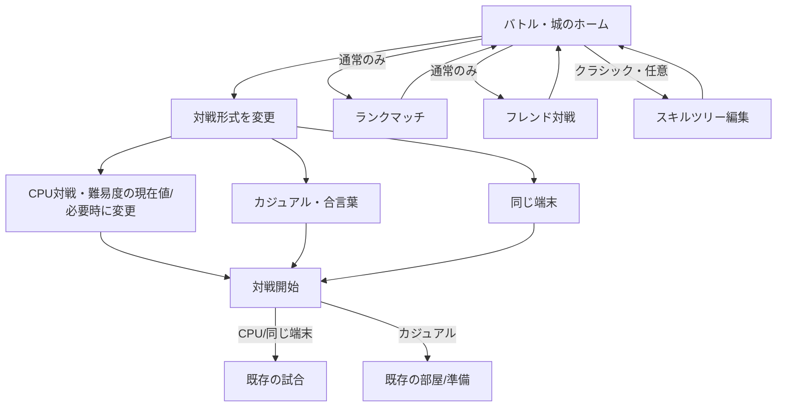

# プレイヤーの目的に合わせた画面の仕上げ（PR #202・第5版）

基点は f09eae8（第4版）。独立したガチャ・ショップ・スキン・設定と、ホームから直接対戦する構成を維持。画像は既存素材を使用し、新規生成は行っていない。

## 調査と変更

| 画面 | 調査で分かったこと | 実装した配置・操作 |
|---|---|---|
| ホーム | スマホの城領域が100〜120px。固定高の見出し行と、旧タブレットCSSのヒーロー配置が長いタイトルと競合 | 全幅で明示的なグリッド領域を定義。見出し行は内容に合わせて伸びる。城はスマホ220px、タブレット最大320px、PCは最低360pxの領域に拡大。通常3Dも既存カメラの領域追従を利用 |
| CPU難易度 | 3枚の兵士・騎士カードが常時場所を占める | 現在の絵・難易度・「変更」の約52pxの行へ。開いた時だけ3択、選択後は閉じてフォーカスを戻す。選択はルールセット別に保存、選択だけでは試合を始めない |
| 対戦への入口 | CPU/カジュアル/同じ端末はバトル、ランク/フレンドはメニューに離れていた | バトルに形式変更とランク/フレンドを集約。メニューから同じ入口を撤去。フレンド通知もバトルタブへ。通常以外のランク/フレンド非表示と既存の開始時チェックを維持 |
| ガチャ | 一般的な商品パネルと城スキンの見本が主役に見える | 専用の宝箱絵を大きく配置。PCは宝箱と操作を左右に、スマホは宝箱→天井/価格→抽選の縦順。見本/確率/履歴は必要時に展開 |
| 獲得演出 | 結果をページ本文に置くため背後の操作と区別しづらい | 宝箱→開封→景品の専用ネイティブdialog。背景入力を遮断し、二重抽選を防止。1回/10連、NEW/重複ポイント、スキップ/動きを減らすを維持。Escapeは結果だけを閉じてガチャへ戻る |
| ショップ | 商品種別だけでは多い商品から目的の品を探しづらい | 名前/キャラ名検索、種類、「コインで購入/ポイントで交換」、価格/レア度/名前順、買える品だけの絞り込み。件数/条件解除を表示。初回24件、追加24件ずつ。検索入力のフォーカスは再描画しても維持 |
| スキン装備 | 所持品カードはあるが現在の組み合わせが見えない | 「現在の装備」に城・歩兵・カード裏面を並べ、装備/解除のサーバー応答後に反映。PCは左にプレビュー/右に所持品、スマホはプレビュー→所持品。10種類の装備はそのまま |

ガチャは開封台、ショップは検索と商品一覧、スキンは装備プレビューという別のレイアウトにした。共通の色・輪郭・ボタンは既存デザイントークンを使用。`css/collection.css`に各画面の配置をまとめ、`home.css`に残っていた旧獲得演出の全面背景・最低高・本文置換ルールを撤去した。

ゲーム計算、カード性能、スキル効果/取得条件、CPU戦略、価格/排出率/天井/ポイント、装備APIは変更していない。今回の差分はUI・UIテスト・資料・PWA一覧のみ。`js/game/`、`data/`、`server/`、`tests/`、`js/main.js`は前版から差分なし。

## 対戦の導線



通常/4陣営/クラシックの使用デッキ・陣営・スキル編集の出し分けは第4版と同じ。独立した主ナビのガチャ/ショップ、メニューからのスキン/設定は維持。低い横向き画面は設定と開始ボタンまで縦スクロールできる構成、スマホ縦/タブレットは既存の固定開始ボタンを使用する。

## 検証・画面資料

[PC・スマホの画面ギャラリー](../assets/review/player-layout-v5/README.md)に前版比較、通常3D、開封前後、検索/交換、装備後、各モードを収録。

- `player-layout.js`: PC/実タッチのスマホで現在値・難易度保存・閉じる操作、商品検索/入力フォーカス/並べ替え/ページ追加/条件解除/購入/交換、城/兵士の装備プレビュー、実APIの1回/10連と抽選要求数、Escape後の戻り先を確認。4サイズ×3モードの配置を含む14ケース。
- `navigation.js`: PC/スマホ×3モード×CPU/同じ端末の12経路で直接開始。実Gameの3人/氷ステージ/山札形式、任意スキル取得と保存/再読込、オンライン入室、プロフィール/設定等、追加サイズを含む17ケース。
- `navigation-extras.js`: 移動したランク/フレンドとランク報酬、ランキング、ミッション、ヘルプ、編成、図鑑の入口/戻り先、PC/スマホ16画面。
- `navigation-edgecases.js`: 実タップ、入室失敗後の再試行、呼出元へ戻る、共通/個別山札、見本/保存枠の切替と実カードの一致、未編集クラシックの開始、オフライン時の案内、6ケース。
- `player-home-3d.js`: 通常WebGLのホームをPC/スマホで確認。WebGLコンテキストが有効、拡大した城領域が210px以上、ページエラーなし。
- PWA `castlefield-51ef9c7d1f89403a` / 874件で、通信を切った後の設定変更・201ノード表示・4陣営の固定デッキでの直接開始が成功。配信WebP14枚、原画混入ゼロ。
- `smoke.js`: 通常UIでホーム→難易度→開始→マリガン→兵士/カード操作→自然決着（51手番）→結果/再戦。今回のスモークは2D表示、エラー/同期警告なし。前版の通常3D自然決着（11手番）は[前版資料](../assets/review/navigation-v4/README.md)を参照。
- 既存の経済・ランクスキン・ツリーUI・ホーム空・4陣営/クラシックのテスト計74件成功。HTTPを使う経済テストはローカル待受が許可された環境で実行。

購入/抽選/交換のテスト用通貨は専用メモリDBだけへ投入。実アカウントやゲームデータには触れていない。補助画面の確認で他人への招待/チャットやランクのマッチング要求は送っていない。

## 実行手順

Node 22.7以降、環境のPlaywright/Chromiumを使用する。リポジトリに新しい依存は追加しない。

```sh
# 自動でメモリDBのサーバーを起動し、実APIとPC/スマホを検証・撮影
node ui-tests/player-layout.js
UI_REVIEW_DIR=../assets/review/player-layout-v5/routes/ node ui-tests/navigation.js

# 既存サーバーを起動（以下は一時DBのみを使用）
PORT=3000 CF_DB_PATH=/tmp/castle-player-review.sqlite node server/server.js

# 別端末で通常3Dホーム・補助画面・PWAを確認
UI_TEST_URL=http://127.0.0.1:3000/ node ui-tests/player-home-3d.js
UI_TEST_URL=http://127.0.0.1:3000/ UI_REVIEW_DIR=../assets/review/player-layout-v5/routes/ node ui-tests/navigation-extras.js
UI_TEST_URL=http://127.0.0.1:3000/ UI_TEST_CHROMIUM=/usr/bin/chromium UI_REVIEW_DIR=../assets/review/player-layout-v5/offline/ node ui-tests/home-offline.js
```

手動では `http://localhost:3000/?home=1` を開く。CPUの現在値→変更→選択で試合が始まらないこと、対戦形式の3択とランク/フレンドの入口、ガチャの1回/10連、ショップの検索と価格順、購入後のスキン装備→プレビューを確認する。`?home=1&fx=lite` は2Dの軽量プレビュー。配信内容を編集した場合は `node js/ui/build-precache.js` でPWA一覧を再生成する。

## 未対応・確認範囲

装備プレビューは既存イラストを用いた静止表示で、城・歩兵・カード裏面の現在値が対象。個別キャラ/魔法など全スキンは所持品カードの見本で確認できる。3Dの試着・動作再生は追加していない。

iPhone実機/WebKit、指の感触、音、長時間GPU/電池、2人のオンライン通し対戦は未実施。WebKitは前版で不足ライブラリにより起動できなかったため、今回も実機確認済みとは扱わない。
